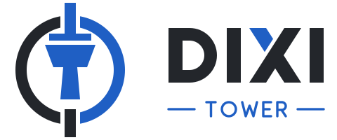

<p align="center">
  <picture>
    <source media="(prefers-color-scheme: dark)" srcset="docs/assets/logo-dark.svg">
    
  </picture>
</p>

<p align="center"><strong>Una torre de control local para tus agentes de código.</strong></p>

# Dixi Tower

[English](README.md) · **Español** · **[Manual de operación](docs/manual.es.md)**

## Propósito

Cuando trabajas con varios agentes de código a la vez, en distintos repositorios, es difícil saber cuál está trabajando, cuál terminó y cuál espera tu respuesta. Dixi Tower los reúne en un solo lugar.

Dixi Tower es una torre de control local para agentes de código. Lanza sesiones de agentes de código en tu propia máquina (Claude Code, Codex o cualquier agente que abras desde la terminal), cada una en su worktree y su rama de git, y te deja verlas y dirigirlas todas desde un panel web en `http://localhost:4310/`.

Funciona con la suscripción que ya tienes: sin llaves de API, sin servicio en la nube, y nada sale de tu máquina salvo lo que hagan los propios agentes.

> **Estado: alfa.** Probado en macOS con Claude Code y Codex, y en Linux (Debian 12). En Windows corre dentro de WSL2, probado en Windows Server 2025 con Ubuntu. En Linux y Windows el panel se levanta con `dixi-tower panel`; el servicio siempre encendido es solo de macOS. Ver la [hoja de ruta](ROADMAP.md).

## Qué ofrece

- **Un panel para todos los agentes**: búsqueda, filtro por estado y orden por quién te está esperando.
- **Consola en vivo** de cada agente, con enlaces clicables y control por teclado (flechas, Enter, Esc, 1–3).
- **Autocompletado de comandos «/»**: los del motor, los tuyos y los instalados en el proyecto (por ejemplo los `/dixi.*` de [dixi-spec-kit](https://github.com/dixi-project/dixi-spec-kit)).
- **Ciclo completo de la sesión**: lanzar, detener, encender de nuevo (retomando la conversación) y eliminar.
- **Trae tu propio agente**: además de Claude Code y Codex, define como motor cualquier agente de terminal.
- **Archivos y rutas en el mensaje**: arrastra o pega archivos e imágenes, o elige una carpeta, y su ruta se inserta para el agente.
- **Dictado**: mantén presionada la barra espaciadora para hablar en vez de escribir (usa el reconocimiento de voz del navegador).
- **Ajustes por agente**: motor, nivel de autonomía, subagentes permitidos y cuántos, y límites de uso de la cuenta.
- **Barreras**: un agente nunca integra, despliega, publica en la rama base ni lee secretos. Termina en un pull request.

## Requisitos

- macOS, Linux o Windows con WSL2 ([cómo](docs/manual.es.md#en-windows-wsl2)); `bash`, Python 3.9 o posterior (solo biblioteca estándar)
- `tmux` y `git`
- Al menos un motor: [Claude Code](https://claude.com/claude-code) o [Codex CLI](https://github.com/openai/codex) con sesión iniciada en tu suscripción, o el tuyo
- Opcional: `gh` (pull requests), `terminal-notifier` en macOS o `notify-send` en Linux (avisos de escritorio)

## Inicio rápido

Instálalo desde [PyPI](https://pypi.org/project/dixi-tower/) con [uv](https://docs.astral.sh/uv/) o pipx:

```sh
uv tool install dixi-tower
# o bien: pipx install dixi-tower
```

Para probar los últimos cambios aún sin publicar, instálalo directo desde GitHub: `uv tool install git+https://github.com/dixi-project/dixi-tower`.

Después:

```sh
dixi-tower doctor               # revisa requisitos
dixi-tower servicio instalar    # panel siempre encendido en http://localhost:4310/ (macOS)
dixi-tower panel                # o bien: el panel dentro de tmux (cualquier sistema)
```

Abre el panel y pulsa **＋ Nuevo agente**. Elige un repositorio de tu carpeta de proyectos (`~/projects` por defecto; se cambia con `DIXI_TOWER_PROJECTS`), escribe una instrucción y lánzalo.

> **Paso a paso, con capturas:** el [manual de operación](docs/manual.es.md) cubre la instalación, la configuración y el uso diario.

Ejecuta `dixi-tower` sin argumentos para ver todos los comandos. Todo está en español e inglés, según el idioma de tu sistema (o `DIXI_TOWER_LANG=es|en`).

## Cómo funciona

Cada agente es una sesión interactiva del motor dentro de una ventana de la sesión tmux `dixi-tower`. Dixi Tower inyecta permisos, hooks y reglas desde fuera, así que el repositorio del proyecto nunca se modifica. Los hooks reportan el estado de cada agente en `~/.dixi-tower/`, y el panel lee esos archivos, git y tmux.

¿Primera vez? El [manual de operación](docs/manual.es.md) te lleva por la instalación, la configuración y el uso diario, con capturas. La referencia completa (comandos, configuración, piezas internas y seguridad del panel) está en [docs/uso.md](docs/uso.md).

## Seguridad

El panel escucha solo en `127.0.0.1`, rechaza peticiones cuya cabecera `Host` no sea local y exige un token para toda acción que escribe. Quien pueda abrir el panel puede dar instrucciones a tus agentes: no lo expongas por túnel ni proxy.

## Licencia

[MIT](LICENSE) © 2026 Dixi Project.

## Links

- [Hoja de ruta](ROADMAP.md)
- [Registro de cambios](CHANGELOG.md)
- [Manual de operación](docs/manual.es.md)
- [Guía de uso](docs/uso.md)
