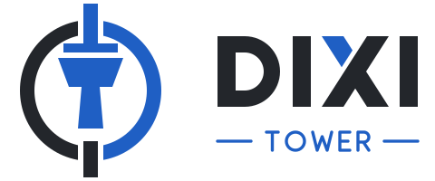

<p align="center">
  <picture>
    <source media="(prefers-color-scheme: dark)" srcset="https://raw.githubusercontent.com/dixi-project/dixi-tower/main/docs/assets/logo-dark.svg">
    
  </picture>
</p>

<p align="center"><strong>A local control tower for your coding agents.</strong></p>

# Dixi Tower

**English** · [Español](https://github.com/dixi-project/dixi-tower/blob/main/README.es.md) · **[Operations manual](https://github.com/dixi-project/dixi-tower/blob/main/docs/manual.md)**

## Purpose

When you run several coding agents at once, in different repositories, it is hard to know which one is working, which one finished and which one is waiting for your answer. Dixi Tower puts them all in one place.

Dixi Tower is a local control tower for coding agents. It launches coding-agent sessions on your own machine (Claude Code, Codex, or any agent you run from a terminal), each in its own git worktree and branch, and lets you watch and steer all of them from one web panel at `http://localhost:4310/`.

It runs on the subscription you already have: no API keys, no cloud service, nothing leaves your machine except what the agents themselves do.

> **Status: alpha.** Tested on macOS with Claude Code and Codex, and on Linux (Debian 12). On Windows it runs inside WSL2, tested on Windows Server 2025 with Ubuntu. The always-on service works on all three (launchd on macOS, systemd on Linux and WSL2). See the [roadmap](https://github.com/dixi-project/dixi-tower/blob/main/ROADMAP.md).

## What you get

- **One panel for every agent**: search, filter by state, sort by who is waiting for you.
- **Live console** of each agent, with clickable links and keyboard control (arrows, Enter, Esc, 1–3).
- **Slash-command autocomplete**: the engine's commands, your own, and the ones installed in the project (for example the `/dixi.*` commands of [dixi-spec-kit](https://github.com/dixi-project/dixi-spec-kit)).
- **Full session lifecycle**: launch, stop, turn back on (resuming the conversation) and delete.
- **Bring your own agent**: besides Claude Code and Codex, define any terminal agent as an engine.
- **Files and paths in the prompt**: drag or paste files and images, or pick a folder, and its path is inserted for the agent.
- **Dictation**: hold the space bar to speak instead of typing (uses your browser's speech recognition).
- **Per-agent settings**: engine, autonomy level, subagents allowed and how many, and account-usage limits.
- **Guardrails**: an agent never merges, deploys, pushes to the base branch or reads secrets. It ends in a pull request.

## Requirements

- macOS, Linux, or Windows with WSL2 ([how](https://github.com/dixi-project/dixi-tower/blob/main/docs/manual.md#on-windows-wsl2)); `bash`, Python 3.9 or later (standard library only)
- `tmux` and `git`
- At least one engine: [Claude Code](https://claude.com/claude-code) or [Codex CLI](https://github.com/openai/codex) signed in with your subscription, or your own
- Optional: `gh` (pull requests), `terminal-notifier` on macOS or `notify-send` on Linux (desktop notifications)

## Quickstart

Install from [PyPI](https://pypi.org/project/dixi-tower/) with [uv](https://docs.astral.sh/uv/) or pipx:

```sh
uv tool install dixi-tower
# or: pipx install dixi-tower
```

To try the latest unreleased changes, install straight from GitHub: `uv tool install git+https://github.com/dixi-project/dixi-tower`.

Then:

```sh
dixi-tower doctor               # check requirements
dixi-tower service install      # panel always on at http://localhost:4310/ (macOS, Linux, WSL2)
dixi-tower panel                # or: run the panel inside tmux (any system)
```

Open the panel and click **＋ New agent**. Pick a repository from your projects folder (`~/projects` by default, change it with `DIXI_TOWER_PROJECTS`), type an instruction and launch.

> **Step by step, with screenshots:** the [operations manual](https://github.com/dixi-project/dixi-tower/blob/main/docs/manual.md) covers installation, setup and daily use.

Run `dixi-tower` with no arguments to list every command. Everything is available in English and Spanish, following your system language (or `DIXI_TOWER_LANG=en|es`).

## How it works

Each agent is an interactive session of the engine inside a window of the `dixi-tower` tmux session. Dixi Tower injects permissions, hooks and rules from outside, so the project repository is never modified. Hooks report each agent's state to `~/.dixi-tower/`, and the panel reads those files, git and tmux.

New to Dixi Tower? The [operations manual](https://github.com/dixi-project/dixi-tower/blob/main/docs/manual.md) walks you through installation, setup and daily use, with screenshots. The full reference (commands, settings, internals, security of the panel) is in [docs/usage.md](https://github.com/dixi-project/dixi-tower/blob/main/docs/usage.md).

## Security

The panel listens on `127.0.0.1` only, rejects requests whose `Host` header is not local, and requires a token for every action that writes. Anyone who can open the panel can give instructions to your agents: do not expose it through a tunnel or proxy.

## License

[MIT](https://github.com/dixi-project/dixi-tower/blob/main/LICENSE) © 2026 Dixi Project.

## Links

- [Roadmap](https://github.com/dixi-project/dixi-tower/blob/main/ROADMAP.md)
- [Changelog](https://github.com/dixi-project/dixi-tower/blob/main/CHANGELOG.md)
- [Operations manual](https://github.com/dixi-project/dixi-tower/blob/main/docs/manual.md)
- [Usage guide](https://github.com/dixi-project/dixi-tower/blob/main/docs/usage.md)
