# Manual de operación de Dixi Tower

[English](manual.md) · **Español**

## Propósito

Recorrido paso a paso por Dixi Tower, de la instalación a la operación del día a día, con capturas de lo que vas a ver. Para cada opción y detalle interno, consulta la [guía de uso](uso.md).

Las capturas salen de una demo con dos repositorios de ejemplo: `acme-store` (una tienda estática, con Claude Code) y `acme-api` (una API pequeña en Python con lista de tareas, con Codex).

## Contenido

1. [Instalar](#1-instalar)
2. [Levantar el panel](#2-levantar-el-panel)
3. [Fijar tus valores de partida](#3-fijar-tus-valores-de-partida)
4. [Lanzar un agente](#4-lanzar-un-agente)
5. [La primera vez en un repositorio](#5-la-primera-vez-en-un-repositorio)
6. [Seguir a tus agentes](#6-seguir-a-tus-agentes)
7. [Cuando un agente te necesita](#7-cuando-un-agente-te-necesita)
8. [Hablar con un agente](#8-hablar-con-un-agente)
9. [Cambiar los ajustes de un agente](#9-cambiar-los-ajustes-de-un-agente)
10. [Detener, encender de nuevo y eliminar](#10-detener-encender-de-nuevo-y-eliminar)
11. [Cuando el agente termina](#11-cuando-el-agente-termina)
12. [Problemas frecuentes](#12-problemas-frecuentes)

## 1. Instalar

Necesitas macOS, Linux o Windows con WSL2 (ver [En Windows](#en-windows-wsl2)), con `bash`, Python 3.9 o posterior, `tmux`, `git` y al menos un motor con sesión iniciada en tu suscripción: [Claude Code](https://claude.com/claude-code) o [Codex CLI](https://github.com/openai/codex). Opcional: `gh` para que los agentes abran pull requests, y `terminal-notifier` (macOS) o `notify-send` (Linux) para los avisos de escritorio; en Windows funcionan sin instalar nada.

En macOS, con [Homebrew](https://brew.sh):

```sh
brew install tmux git gh terminal-notifier uv
```

Instala Dixi Tower desde PyPI:

```sh
uv tool install dixi-tower
# o bien: pipx install dixi-tower
```

Para probar los últimos cambios aún sin publicar, instálalo directo desde GitHub: `uv tool install git+https://github.com/dixi-project/dixi-tower`.

Comprueba que todo está en su sitio (salida de ejemplo):

```console
$ dixi-tower doctor
Requisitos
  ✓ Python 3.13.1
  ✓ bash — /bin/bash
  ✓ git — /opt/homebrew/bin/git
  ✓ tmux — /opt/homebrew/bin/tmux

Motores (hace falta al menos uno)
  ✓ Claude Code — 2.1.332 (Claude Code)
  ✓ Codex — codex-cli 0.167.0

Opcionales
  ✓ gh — para que los agentes abran pull requests
  ✓ terminal-notifier — avisos que abren el panel al hacer clic

Instalación
  ✓ Carpeta de datos — /Users/tu-usuario/.dixi-tower
  ✓ Carpeta de proyectos — /Users/tu-usuario/projects
  ✓ Panel — http://localhost:4310/
  ✓ Servicio (siempre encendido)

Todo lo imprescindible está.
```

Una línea con ✗ te dice qué falta. Ejecuta `dixi-tower` sin argumentos para ver todos los comandos. Todo sale en el idioma de tu sistema; para fijarlo, usa `DIXI_TOWER_LANG=es`.

### En Windows (WSL2)

Dixi Tower funciona en Windows dentro de WSL2, el Linux que viene con Windows 10 y 11. El panel se abre en tu navegador de Windows de siempre. Probado en Windows Server 2025 con Ubuntu: instalación, `doctor`, el panel en Edge, un agente con Claude Code y avisos de Windows que abren el agente al hacer clic.

1. En PowerShell como administrador, instala WSL con Ubuntu y reinicia cuando te lo pida:
   ```powershell
   wsl --install
   ```
   En Windows Server, `wsl --install` puede limitarse a responder que WSL no está instalado. En ese caso instala el `wsl.*.x64.msi` más reciente de las [versiones de WSL](https://github.com/microsoft/WSL/releases), reinicia y ejecuta `wsl --install -d Ubuntu`.
2. Abre **Ubuntu** desde el menú Inicio e instala los requisitos:
   ```sh
   sudo apt update && sudo apt install -y tmux git python3 pipx gh
   pipx ensurepath
   ```
3. Instala tu motor (Claude Code o Codex) **dentro de Ubuntu**, con sus instrucciones para Linux, e inicia sesión ahí. Un motor instalado del lado de Windows no cuenta.
4. Guarda tus repositorios **dentro de Linux**, en `~/projects`. Clónalos ahí en lugar de usar `C:\` (`/mnt/c/…`), donde git va muy lento; `dixi-tower doctor` te avisa si están en el disco de Windows.
5. Instala Dixi Tower con `pipx install dixi-tower`, déjalo siempre encendido con `dixi-tower servicio instalar` y abre **http://localhost:4310/** en tu navegador de Windows. Edge y Chrome pueden instalar el panel como app (**⋯ → Aplicaciones → Instalar este sitio como aplicación**) para tener su ícono en el menú Inicio y la barra de tareas.

El servicio necesita systemd en WSL, que las imágenes recientes de Ubuntu traen activado. Si `servicio instalar` dice que no lo está, añade `[boot]` y `systemd=true` a `/etc/wsl.conf`, ejecuta `wsl --shutdown` en PowerShell, abre Ubuntu de nuevo y repite. El servicio añade además **Dixi Tower** a las aplicaciones de inicio de Windows: al iniciar sesión despierta WSL en segundo plano, sin ventana, y lo mantiene encendido, así que el panel está ahí aunque no tengas ninguna ventana de Ubuntu abierta. Puedes verlo o desactivarlo en **Administrador de tareas → Aplicaciones de inicio**; `dixi-tower servicio quitar` quita las dos cosas.

Los avisos usan las notificaciones propias de Windows a través de PowerShell, sin instalar nada más.

**Tu carpeta de proyectos.** Dixi Tower ofrece los repositorios git que hay dentro de una carpeta de proyectos. Cámbiala desde el panel, en **Configuración › Proyectos** (sección 3): escribe la ruta o pulsa **Elegir…**. Se aplica al guardar, sin reiniciar. Si no la fijas allí, se usa la variable `DIXI_TOWER_PROJECTS` (por ejemplo en tu `~/.zshrc`, antes de levantar el panel) y, si tampoco existe, `~/projects`:

```sh
export DIXI_TOWER_PROJECTS="$HOME/code"
```

Manda lo que fijes en Configuración, luego la variable y al final `~/projects`. También puedes lanzar un repositorio que esté en cualquier otro sitio, sin carpeta de proyectos (sección 4).

## 2. Levantar el panel

```sh
dixi-tower servicio instalar   # siempre encendido, arranca con tu sesión (macOS, Linux, WSL2)
dixi-tower panel               # cualquier sistema: el panel dentro de tmux
```

Abre **http://localhost:4310/**. Se abre en el idioma de tu navegador; cámbialo con **ES · EN**, abajo a la izquierda.

La columna izquierda es tu lista de agentes; a la derecha está el agente elegido. El panel solo escucha en tu propia máquina. Sin agentes, la lista te invita a pulsar **＋ Nuevo agente**.

## 3. Fijar tus valores de partida

**Configuración**, en la columna izquierda, fija los valores con los que nace cada agente nuevo. Tiene tres pestañas (se recorren con las flechas del teclado): **Agentes**, **Proyectos** y **Tareas**.

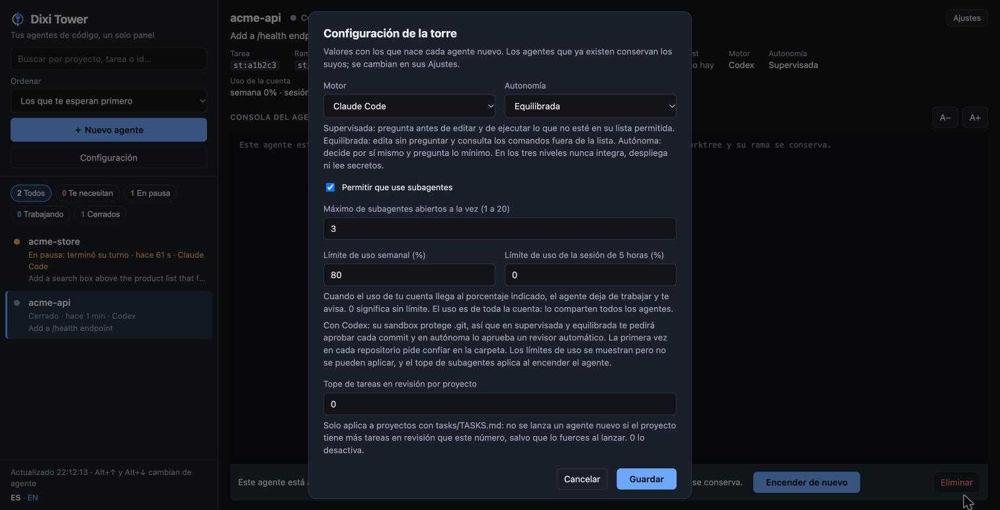

> Las capturas de Configuración y de Nuevo agente de este manual son anteriores a las pestañas y al campo «Otro repositorio (ruta)…»; se actualizarán.

**Agentes**

| Ajuste | Qué decide |
|---|---|
| **Motor** | Claude Code, Codex o un motor propio |
| **Autonomía** | **Supervisada** pregunta antes de editar y antes de comandos fuera de su lista. **Equilibrada** edita sin preguntar y consulta los demás comandos. **Autónoma** pregunta lo mínimo |
| **Subagentes** | Si el agente puede abrir ayudantes, y cuántos a la vez |
| **Límites de uso** | Porcentaje del uso semanal y de 5 horas de tu cuenta en el que los agentes se detienen y te avisan. 0 es sin límite |

**Proyectos**

| Opción | Qué decide |
|---|---|
| **Usar la predeterminada** | La de la variable `DIXI_TOWER_PROJECTS` o, si no existe, `~/projects`. La pestaña dice cuál es y de dónde sale |
| **Esta carpeta** | La ruta que escribes o eliges con **Elegir…** (solo se puede navegar dentro de tu carpeta personal; una ruta de fuera se puede escribir a mano) |
| **Ninguna** | No hay carpeta de proyectos: al lanzar cada agente se pide la ruta del repositorio |

**Tareas**

| Ajuste | Qué decide |
|---|---|
| **Tope de tareas en revisión** | Solo para proyectos con lista de tareas (sección 4) |
| **Dirección de tu tablero de tareas** | Opcional, con `http://` o `https://`. Si la pones, el panel muestra un enlace al tablero abajo a la izquierda; vacía, desaparece |

En cualquier nivel, un agente nunca integra, despliega, publica en la rama base ni lee secretos: termina en un pull request.

Cada agente puede tener después sus propios valores (sección 9).

**Las reglas de tu equipo.** Para que todos los agentes sigan tus convenciones (idioma de los commits, tamaño máximo de un pull request, archivos que no se tocan), escríbelas en `~/.dixi-tower/reglas.md`. Se suman a las reglas de cada agente la próxima vez que se enciende.

## 4. Lanzar un agente

Pulsa **＋ Nuevo agente**.

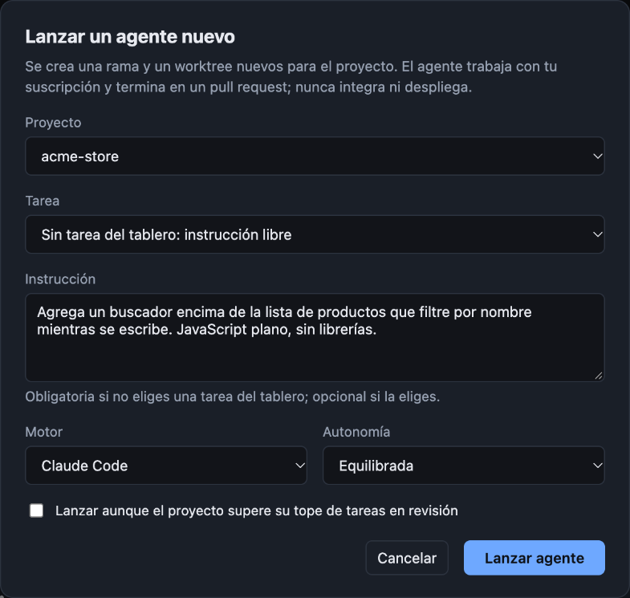

1. **Proyecto**: elige un repositorio de tu carpeta de proyectos. Si el tuyo está en otro sitio, elige **Otro repositorio (ruta)…**, escribe la ruta absoluta de su raíz (la carpeta que contiene `.git`) o pulsa **Elegir…**. Si pusiste **Ninguna** en Configuración › Proyectos, el formulario pide solo la ruta.
2. **Instrucción**: lo que quieres que haga, con tus palabras.
3. **Motor** y **Autonomía**: arrancan con tus valores de partida; cámbialos para este agente si quieres.
4. **Lanzar agente**.

Dixi Tower crea una rama nueva y un worktree aparte para el agente, así que tu copia de trabajo nunca se toca, y abre la sesión del agente.

**Con lista de tareas.** Si el repositorio tiene un `tasks/TASKS.md` con líneas como `- [ ] **Add a /health endpoint** _(P1)_ <!-- st:a1b2c3 -->`, el campo **Tarea** ofrece sus tareas pendientes por prioridad. Elige una y la instrucción pasa a ser opcional.

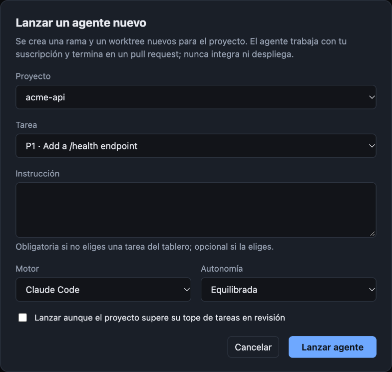

Puedes tener varios agentes a la vez, incluso en el mismo proyecto: el segundo se llama `<proyecto>@2`, y así sucesivamente.

## 5. La primera vez en un repositorio

La primera vez que un motor abre un repositorio, pregunta si confías en la carpeta. El agente aparece en rojo como **Te necesita**. (Estas dos capturas están con el panel en inglés; la pregunta del motor sale en inglés en cualquier caso.)

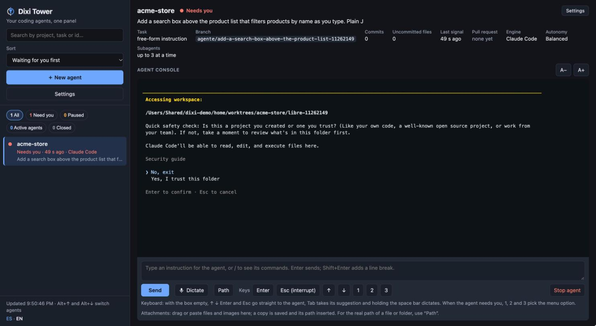

Responde desde el panel con los botones de teclas que hay bajo la caja de texto, o con tu teclado mientras la caja está vacía. Con Claude Code, pulsa **↓** para elegir «Yes, I trust this folder» y luego **Enter**.

Codex pregunta lo mismo con sus palabras; **Enter** elige «Trust and continue».

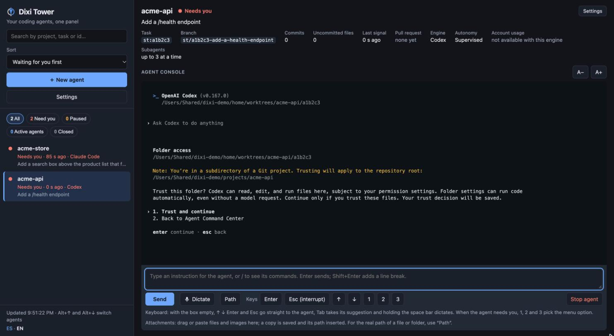

Cada motor recuerda tu respuesta para ese repositorio, así que los agentes siguientes arrancan directamente.

## 6. Seguir a tus agentes

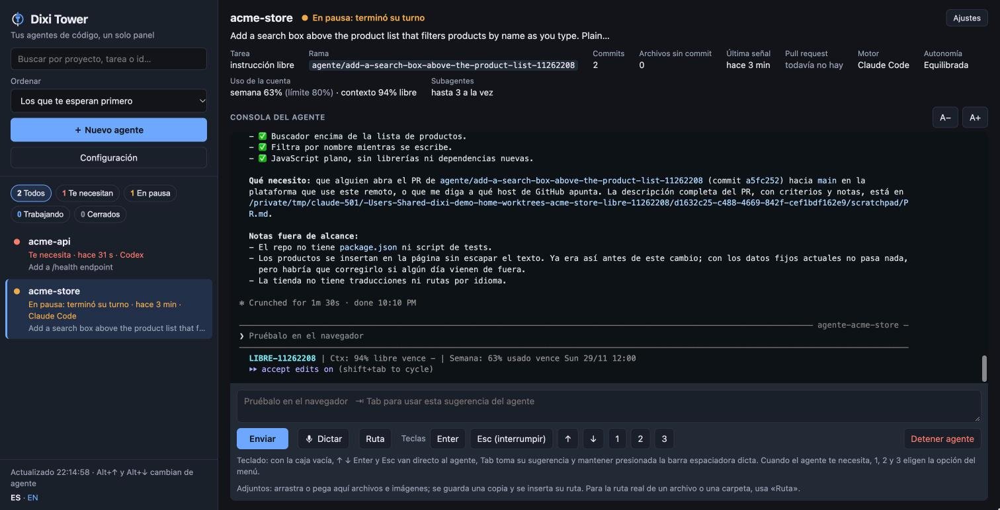

**La lista.** Cada agente muestra su estado, hace cuánto dio su última señal, su motor y su encargo. Los contadores de arriba filtran la lista, el buscador encuentra un agente por proyecto, tarea o id, y **Ordenar** pone primero a los que te esperan.

| Estado | Qué significa |
|---|---|
| **Trabajando** (azul) | El agente está ocupado; no tienes que hacer nada |
| **Te necesita** (rojo) | Espera tu respuesta: un permiso, una elección, una pregunta |
| **En pausa: terminó su turno** (ámbar) | Terminó lo que estaba haciendo y espera tu siguiente mensaje |
| **Cerrado** (gris) | La sesión está apagada; su worktree y su rama se conservan |

**La ficha del agente** muestra su tarea, rama, commits, archivos sin commit, última señal, pull request, motor, autonomía, uso de la cuenta y subagentes.

**La consola** muestra la pantalla del agente en vivo. Los enlaces se pueden abrir, y **A− / A+** cambian el tamaño de la letra.

Cambia de agente con **Alt+↑ / Alt+↓**. Cuando un agente se detiene o te necesita, también recibes un aviso de escritorio; al hacer clic se abre ese agente en el panel.

## 7. Cuando un agente te necesita

Cuando un agente pide un permiso o una decisión, sube al principio de la lista en rojo y su consola muestra la pregunta con opciones numeradas.

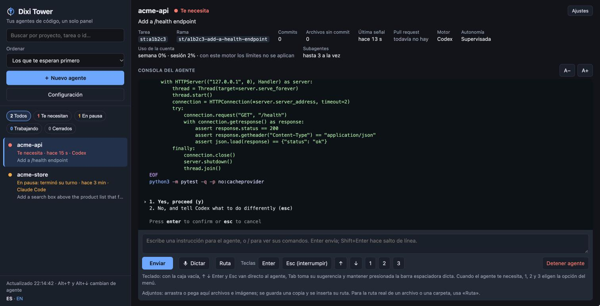

Responde con **1**, **2** o **3** para elegir una opción, **↑ / ↓** y **Enter** para moverte y confirmar, o **Esc** para cancelar. Los botones y tu teclado (con la caja de texto vacía) hacen lo mismo.

Codex en supervisada y equilibrada pregunta antes de cada edición y de cada commit, porque su sandbox protege `.git`. Claude Code en equilibrada edita por su cuenta y solo pregunta por comandos fuera de su lista.

## 8. Hablar con un agente

Escribe en la caja bajo la consola y pulsa **Enter** para enviar (**Shift+Enter** hace salto de línea).

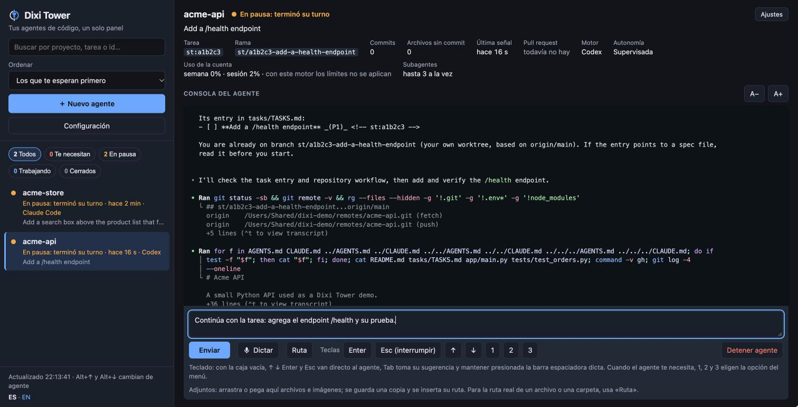

- **Sugerencias.** Cuando el agente propone un siguiente paso, aparece en gris dentro de la caja: pulsa **Tab** para tomarlo (en la captura de la sección 6, «Pruébalo en el navegador»).
- **Comandos.** Escribe `/` para ver los comandos que entiende el agente: los del motor, los tuyos y los instalados en el proyecto. **↑ ↓** eligen, **Tab** o **Enter** completan.

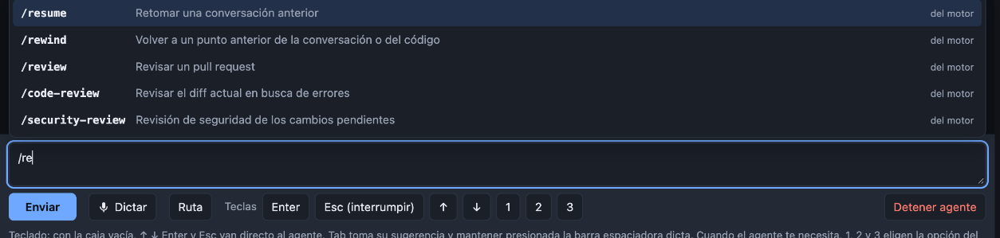

- **Archivos e imágenes.** Arrástralos o pégalos sobre la caja. El navegador no revela la ruta real de lo que sueltas, así que el panel guarda una copia (hasta 25 MB) e inserta su ruta.
- **Rutas reales.** **Ruta** abre un explorador de las carpetas de tu carpeta personal e inserta la ruta real del archivo o carpeta que elijas, sin copiar nada.
- **Dictado.** Mantén presionada la **barra espaciadora** con la caja vacía, o el botón **Dictar**, y habla; suelta para terminar. El texto queda en la caja para que lo revises. Usa el reconocimiento de voz del navegador, que no es local: Chrome envía el audio a Google y Safari a Apple.
- **Interrumpir.** **Esc (interrumpir)** detiene lo que el agente está haciendo sin cerrarlo.

## 9. Cambiar los ajustes de un agente

**Ajustes**, arriba a la derecha de la ficha de un agente, cambia solo ese agente.

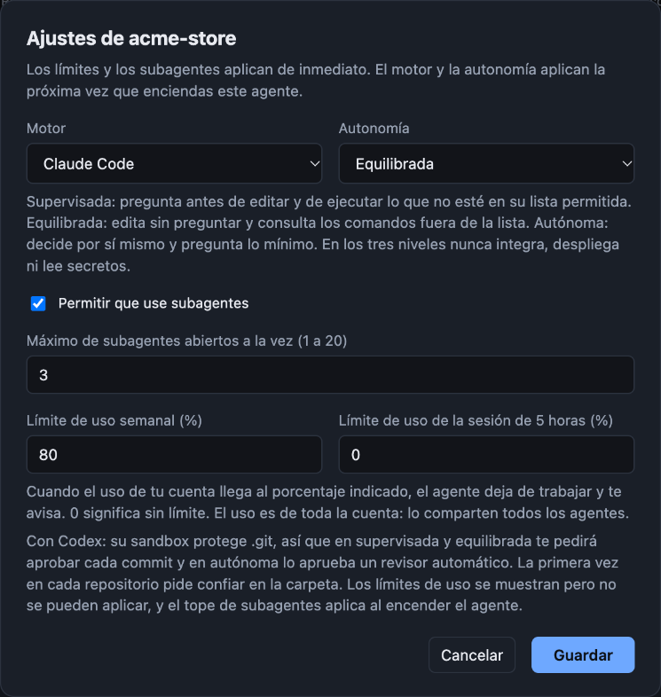

Los límites y los subagentes aplican de inmediato. El motor y la autonomía aplican la próxima vez que enciendas el agente: detenlo y enciéndelo de nuevo.

## 10. Detener, encender de nuevo y eliminar

**Detener agente** cierra la sesión. No se pierde nada: el worktree, la rama y la conversación se conservan.

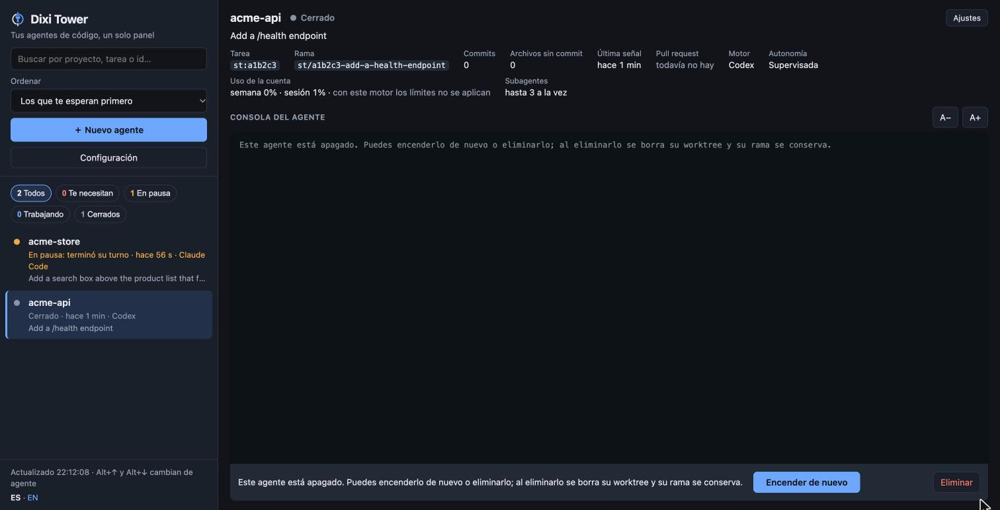

- **Encender de nuevo** vuelve a abrir la sesión y retoma su conversación.
- **Eliminar** quita el agente y su worktree. Solo funciona con el agente detenido y sin archivos sin commit, y siempre conserva la rama con sus commits.

## 11. Cuando el agente termina

Un agente termina abriendo un pull request desde su rama hacia la rama base, con qué cambia, cómo se verificó y el estado de cada criterio de aceptación. Revísalo e intégralo como siempre: Dixi Tower nunca integra.

Si el repositorio no tiene remoto o `gh` no tiene sesión iniciada, el agente lo dice y deja su trabajo con commit en su rama. Es lo que pasó en la captura de la sección 6: el repositorio de la demo no tiene remoto en GitHub, así que el agente pide que alguien abra el pull request y deja escrita su descripción.

Su rama está en tu repositorio (`git branch --list 'agente/*' 'st/*'`), lista para que la publiques o abras el pull request.

## 12. Problemas frecuentes

| Lo que ves | Qué hacer |
|---|---|
| No veo mis proyectos al lanzar un agente | Mira **Configuración › Proyectos**: la carpeta debe existir y tener repositorios git directamente dentro. `dixi-tower doctor` dice qué carpeta usa y de dónde sale. Si el tuyo está en otro sitio, usa **Otro repositorio (ruta)…** |
| El panel no abre | `dixi-tower servicio estado`. Si no responde, `dixi-tower servicio reiniciar` y revisa `~/.dixi-tower/panel.log` |
| «Sin conexión con el panel» | Se reintenta solo; pulsa **Reintentar ahora** para probar ya. Si no vuelve, levántalo de nuevo (`dixi-tower servicio reiniciar` o `dixi-tower panel`) |
| Un agente se queda en **Lanzando** | Mira su consola: puede que el motor te esté preguntando algo o que no tenga sesión iniciada. Inicia sesión con `claude` o `codex` en una terminal |
| El agente dice que llegó al límite de uso | Tu cuenta pasó el porcentaje de Configuración. Sube el límite o espera a que se reinicie la ventana de uso |
| El puerto 4310 está ocupado | Levanta el panel en otro: `DIXI_TOWER_PORT=4320 dixi-tower panel` |
| Quieres ver las consolas tal cual | `tmux attach -t dixi-tower` (Ctrl-b n: siguiente ventana · Ctrl-b d: salir sin detenerlos) |

## Links

- [README](../README.es.md)
- [Guía de uso](uso.md): todos los comandos, ajustes y piezas internas
- [Hoja de ruta](../ROADMAP.md)
