# Dixi Tower operations manual

**English** · [Español](manual.es.md)

## Purpose

A step-by-step walkthrough of Dixi Tower, from installation to daily operation, with screenshots of what you will see. For every option and internal detail, see the [usage guide](usage.md).

The screenshots come from a demo with two sample repositories: `acme-store` (a static storefront, with Claude Code) and `acme-api` (a small Python API with a task list, with Codex).

## Contents

1. [Install](#1-install)
2. [Start the panel](#2-start-the-panel)
3. [Set your defaults](#3-set-your-defaults)
4. [Launch an agent](#4-launch-an-agent)
5. [The first time in a repository](#5-the-first-time-in-a-repository)
6. [Follow your agents](#6-follow-your-agents)
7. [When an agent needs you](#7-when-an-agent-needs-you)
8. [Talk to an agent](#8-talk-to-an-agent)
9. [Change one agent's settings](#9-change-one-agents-settings)
10. [Stop, turn back on and delete](#10-stop-turn-back-on-and-delete)
11. [When the agent finishes](#11-when-the-agent-finishes)
12. [Troubleshooting](#12-troubleshooting)

## 1. Install

You need macOS, Linux or Windows with WSL2 (see [On Windows](#on-windows-wsl2)), with `bash`, Python 3.9+, `tmux`, `git` and at least one engine signed in with your subscription: [Claude Code](https://claude.com/claude-code) or [Codex CLI](https://github.com/openai/codex). Optional: `gh` so agents can open pull requests, and `terminal-notifier` (macOS) or `notify-send` (Linux) for desktop notifications; on Windows they work out of the box.

On macOS, with [Homebrew](https://brew.sh):

```sh
brew install tmux git gh terminal-notifier uv
```

Install Dixi Tower straight from GitHub:

```sh
uv tool install git+https://github.com/dixi-project/dixi-tower
# or: pipx install git+https://github.com/dixi-project/dixi-tower
```

Check that everything is in place (example output):

```console
$ dixi-tower doctor
Requirements
  ✓ Python 3.13.1
  ✓ bash — /bin/bash
  ✓ git — /opt/homebrew/bin/git
  ✓ tmux — /opt/homebrew/bin/tmux

Engines (at least one is required)
  ✓ Claude Code — 2.1.332 (Claude Code)
  ✓ Codex — codex-cli 0.167.0

Optional
  ✓ gh — so agents can open pull requests
  ✓ terminal-notifier — notifications that open the panel on click

Installation
  ✓ Data folder — /Users/you/.dixi-tower
  ✓ Projects folder — /Users/you/projects
  ✓ Panel — http://localhost:4310/
  ✓ Service (always on)

Everything required is in place.
```

A line with ✗ tells you what is missing. Run `dixi-tower` with no arguments to see every command.

### On Windows (WSL2)

Dixi Tower runs on Windows inside WSL2, the Linux that ships with Windows 10 and 11. The panel opens in your usual Windows browser. Tested on Windows Server 2025 with Ubuntu: installation, `doctor`, the panel in Edge, a Claude Code agent and Windows notifications that open the agent on click.

1. In PowerShell as administrator, install WSL with Ubuntu and restart when asked:
   ```powershell
   wsl --install
   ```
   On Windows Server, `wsl --install` may only answer that WSL is not installed. In that case install the latest `wsl.*.x64.msi` from [WSL's releases](https://github.com/microsoft/WSL/releases), restart, and run `wsl --install -d Ubuntu`.
2. Open **Ubuntu** from the Start menu and install the requirements:
   ```sh
   sudo apt update && sudo apt install -y tmux git python3 pipx gh
   pipx ensurepath
   ```
3. Install your engine (Claude Code or Codex) **inside Ubuntu**, following its Linux instructions, and sign in there. An engine installed on the Windows side does not count.
4. Keep your repositories **inside Linux**, in `~/projects`. Clone them there rather than using `C:\` (`/mnt/c/…`), where git is very slow; `dixi-tower doctor` warns you if they are on the Windows drive.
5. Install Dixi Tower with `pipx install git+https://github.com/dixi-project/dixi-tower`, start it with `dixi-tower panel` and open **http://localhost:4310/** in your Windows browser.

Notifications use Windows' own notifications through PowerShell, with nothing extra to install. There is no always-on service: after restarting Windows or running `wsl --shutdown`, start the panel again with `dixi-tower panel`.

**Your projects folder.** Dixi Tower offers the git repositories inside `~/projects`. If yours live elsewhere, set `DIXI_TOWER_PROJECTS` (for example in your `~/.zshrc`) before starting the panel:

```sh
export DIXI_TOWER_PROJECTS="$HOME/code"
```

## 2. Start the panel

```sh
dixi-tower service install   # macOS: always on, starts with your session
dixi-tower panel             # any system: runs the panel inside tmux
```

Open **http://localhost:4310/**. It opens in your browser's language; switch with **ES · EN** at the bottom left.

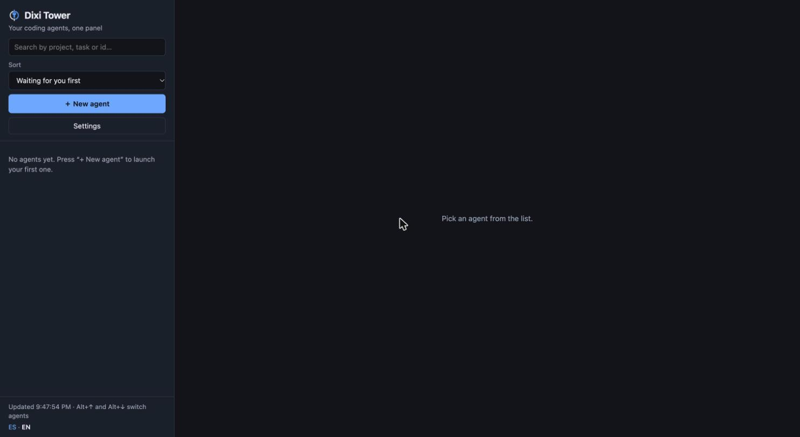

The left column is your list of agents; the right side shows the selected agent. The panel only listens on your own machine.

## 3. Set your defaults

**Settings** in the left column sets the values every new agent starts with.

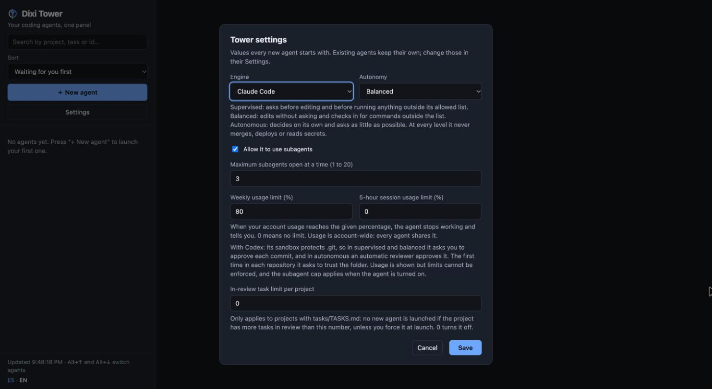

| Setting | What it decides |
|---|---|
| **Engine** | Claude Code, Codex or an engine of your own |
| **Autonomy** | **Supervised** asks before editing and before commands outside its list. **Balanced** edits without asking and checks in for other commands. **Autonomous** asks as little as possible |
| **Subagents** | Whether the agent may open helpers, and how many at once |
| **Usage limits** | Percentage of your account's weekly and 5-hour usage at which agents stop and tell you. 0 means no limit |
| **In-review task limit** | Only for projects with a task list (see section 4) |

At every level, an agent never merges, deploys, pushes to the base branch or reads secrets: it ends in a pull request.

Each agent can later have its own values (section 9).

**Your team's rules.** To give every agent your conventions (commit language, maximum pull request size, files not to touch), write them in `~/.dixi-tower/reglas.md`. They are added to each agent's rules the next time it is turned on.

## 4. Launch an agent

Press **＋ New agent**.

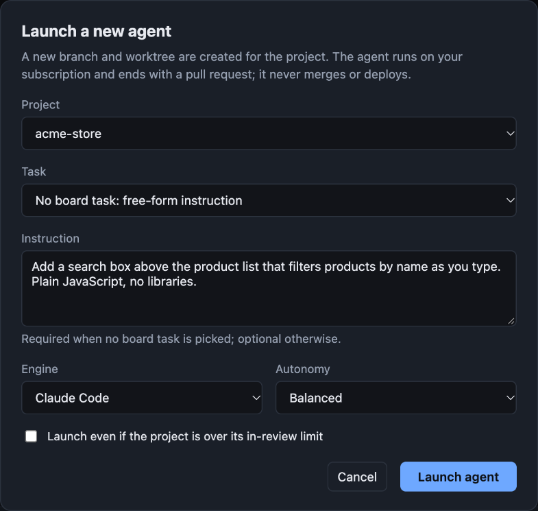

1. **Project**: pick a repository from your projects folder.
2. **Instruction**: what you want done, in your own words.
3. **Engine** and **Autonomy**: they start with your defaults; change them for this agent if you like.
4. **Launch agent**.

Dixi Tower creates a new branch and a separate worktree for the agent, so your own checkout is never touched, and opens the agent's session.

**With a task list.** If the repository has a `tasks/TASKS.md` with lines like `- [ ] **Add a /health endpoint** _(P1)_ <!-- st:a1b2c3 -->`, the **Task** field offers its pending tasks by priority. Pick one and the instruction becomes optional.

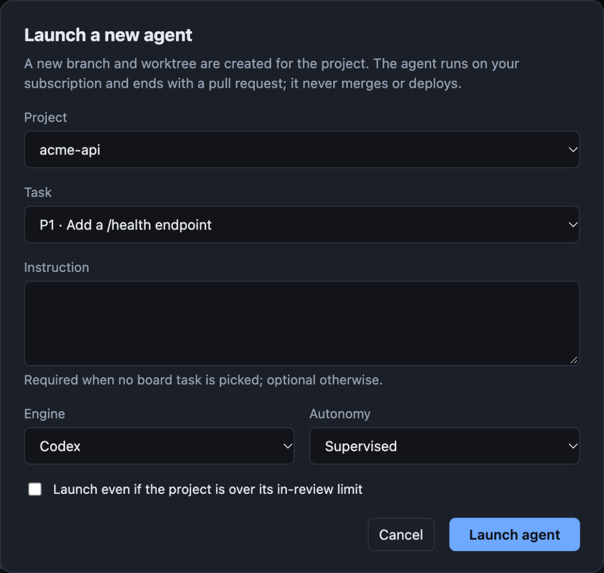

You can run several agents at once, even in the same project: the second is named `<project>@2`, and so on.

## 5. The first time in a repository

The first time an engine opens a repository, it asks whether you trust the folder. The agent shows up as **Needs you** in red.

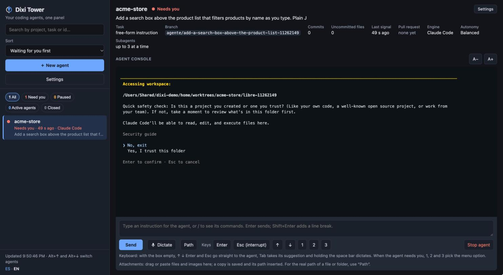

Answer from the panel with the key buttons under the text box, or with your keyboard while the box is empty. For Claude Code, press **↓** to select "Yes, I trust this folder" and then **Enter**.

Codex asks the same thing in its own words; **Enter** picks "Trust and continue".

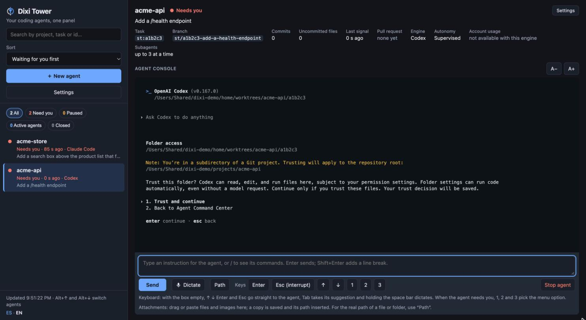

Each engine remembers your answer for that repository, so later agents in it start straight away.

## 6. Follow your agents

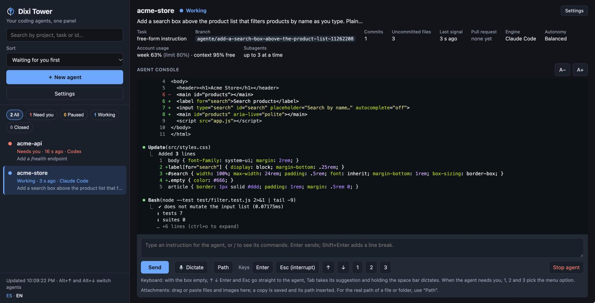

**The list.** Each agent shows its state, how long ago it last signalled, its engine and its task. The counters at the top filter the list, the search box finds an agent by project, task or id, and **Sort** puts the ones waiting for you first.

| State | Meaning |
|---|---|
| **Working** (blue) | The agent is busy; nothing to do |
| **Needs you** (red) | It is waiting for your answer: a permission, a choice, a question |
| **Paused: turn finished** (amber) | It finished what it was doing and is waiting for your next message |
| **Closed** (grey) | The session is off; its worktree and branch are kept |

**The agent's card** shows its task, branch, commits, uncommitted files, last signal, pull request, engine, autonomy, account usage and subagents.

**The console** shows the agent's screen live. Links are clickable, and **A− / A+** change the font size.

Switch agents with **Alt+↑ / Alt+↓**. When an agent stops or needs you, you also get a desktop notification; clicking it opens that agent in the panel.

## 7. When an agent needs you

When an agent asks for permission or a decision, it moves to the top of the list in red, and its console shows the question with numbered options.

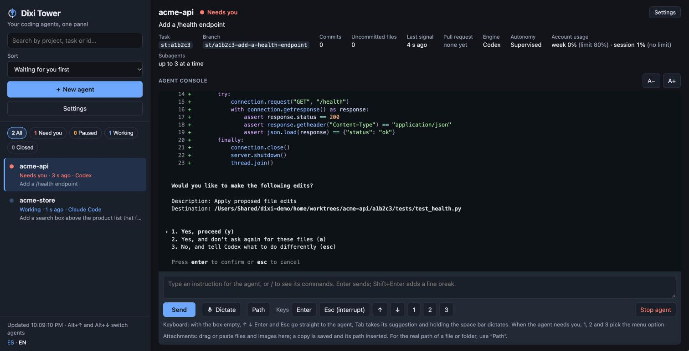

Answer with **1**, **2** or **3** to pick an option, **↑ / ↓** and **Enter** to move and confirm, or **Esc** to cancel. The buttons and your keyboard (with the text box empty) do the same.

Codex in supervised and balanced mode asks before every edit and every commit, because its sandbox protects `.git`. Claude Code in balanced mode edits on its own and only asks for commands outside its list.

## 8. Talk to an agent

Type in the box under the console and press **Enter** to send (**Shift+Enter** adds a new line).

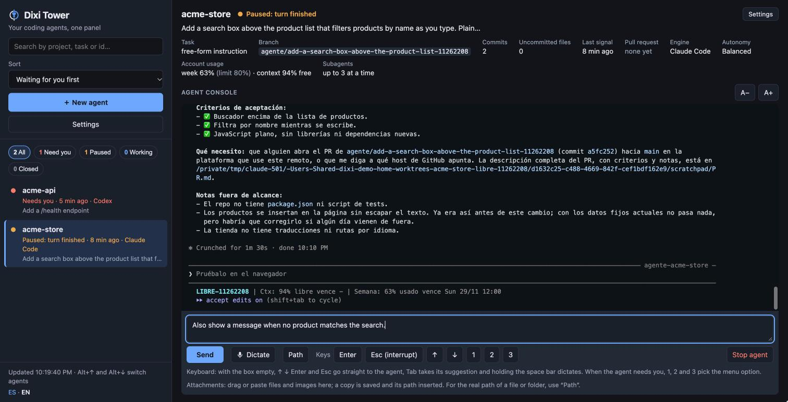

- **Suggestions.** When the agent proposes a next step, it shows in grey inside the box: press **Tab** to take it.
- **Commands.** Type `/` to see the commands the agent understands: the engine's own, yours, and any installed in the project. **↑ ↓** pick one, **Tab** or **Enter** completes it.

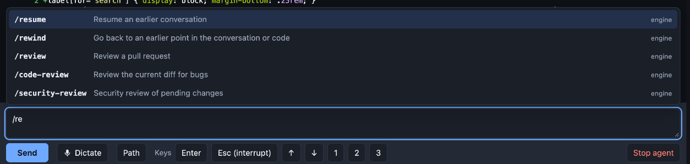

- **Files and images.** Drag or paste them onto the box. The browser does not reveal the real path of what you drop, so the panel saves a copy (up to 25 MB) and inserts its path.
- **Real paths.** **Path** opens a browser of the folders inside your home folder and inserts the real path of the file or folder you pick, without copying anything.
- **Dictation.** Hold the **space bar** with the box empty, or the **Dictate** button, and speak; release to stop. The text stays in the box for you to review. It uses your browser's speech recognition, which is not local: Chrome sends the audio to Google and Safari to Apple.
- **Interrupt.** **Esc (interrupt)** stops what the agent is doing without closing it.

## 9. Change one agent's settings

**Settings** at the top right of an agent's card changes only that agent.

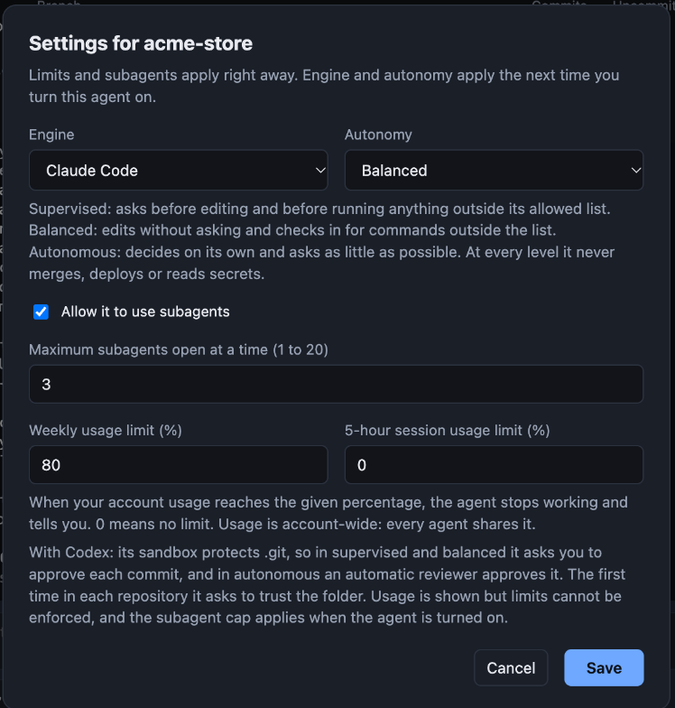

Limits and subagents apply right away. Engine and autonomy apply the next time you turn the agent on: stop it and turn it back on.

## 10. Stop, turn back on and delete

**Stop agent** closes the session. Nothing is lost: the worktree, the branch and the conversation are kept.

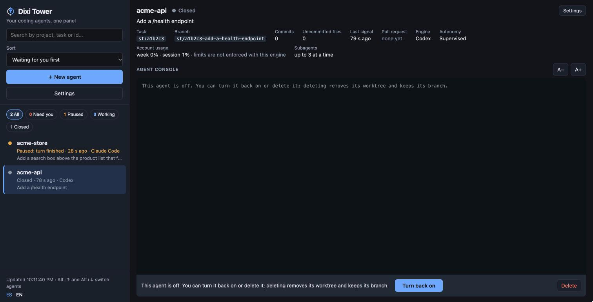

- **Turn back on** opens the session again and resumes its conversation.
- **Delete** removes the agent and its worktree. It only works with the agent stopped and no uncommitted files, and it always keeps the branch with its commits.

## 11. When the agent finishes

An agent finishes by opening a pull request from its branch to the base branch, with what changed, how it was verified and the status of each acceptance criterion. Review and merge it as you always do: Dixi Tower never merges.

If the repository has no remote or `gh` is not signed in, the agent says so and leaves its work committed on its branch. This one ran in a repository without a GitHub remote:

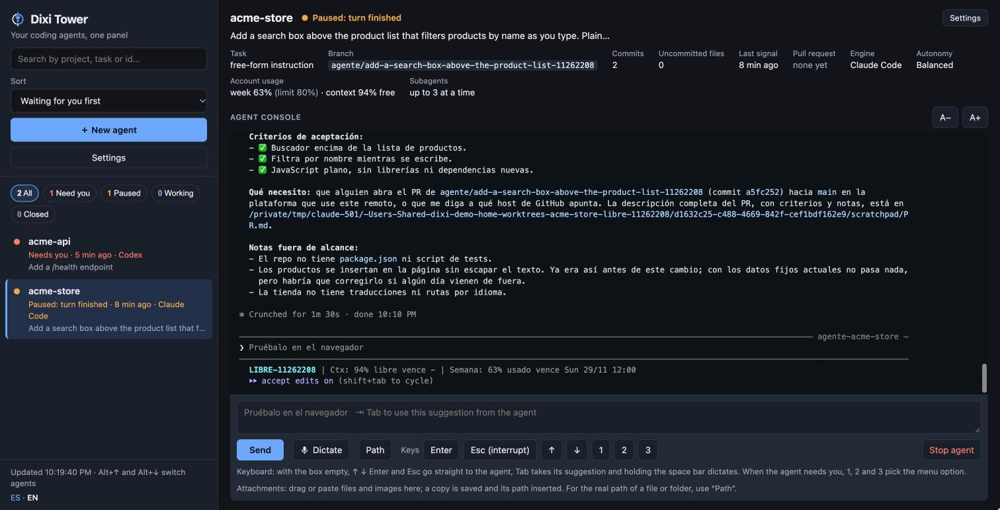

Its branch is in your repository (`git branch --list 'agente/*' 'st/*'`), ready for you to push it or open the pull request.

## 12. Troubleshooting

| What you see | What to do |
|---|---|
| The panel does not open | `dixi-tower service status`. If it is not responding, `dixi-tower service restart` and check `~/.dixi-tower/panel.log` |
| "Lost connection to the dashboard" | It retries on its own; press **Retry now** to try at once. If it does not come back, start it again (`dixi-tower service restart` or `dixi-tower panel`) |
| An agent stays in **Launching** | Look at its console: the engine may be asking you something, or may not be signed in. Sign in with `claude` or `codex` in a terminal |
| The agent says it reached the usage limit | Your account passed the percentage in Settings. Raise the limit or wait for the usage window to reset |
| Port 4310 is taken | Start the panel on another one: `DIXI_TOWER_PORT=4320 dixi-tower panel` |
| You want to see the raw consoles | `tmux attach -t dixi-tower` (Ctrl-b n: next window · Ctrl-b d: leave without stopping them) |

## Links

- [README](../README.md)
- [Usage guide](usage.md): every command, setting and internal piece
- [Roadmap](../ROADMAP.md)
